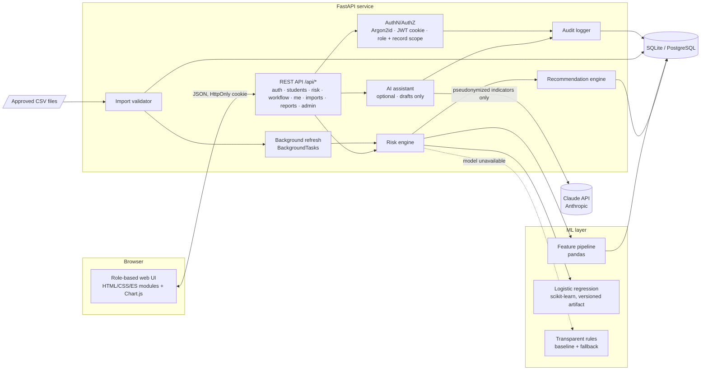
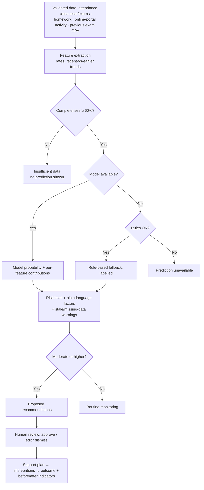
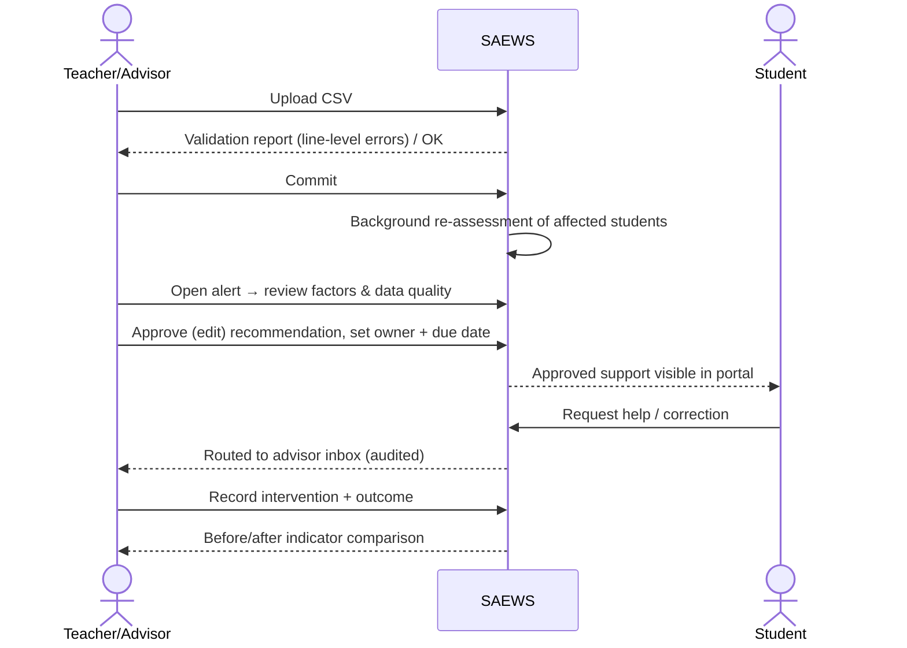
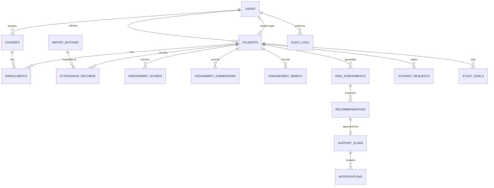

# Architecture

## Overview

## Risk-assessment pipeline (SRS §7.3)

## Activity flow (SRS §7.2)

## Data model (SRS §7.4, extended)

## Authorization model

| Role | Individual student records | Write actions | Reports |
|---|---|---|---|
| Teacher | Students enrolled in own subjects | Review/flag alerts, approve recs, plans, interventions, import indicators for own subjects | Own subjects |
| Advisor (class advisor) | Students in own class group | Same as teacher (no imports) | Own students |
| Student | Self only (no risk labels, approved support only) | Goals, help/correction requests | — |
| Analyst | None | — | De-identified, small cells suppressed; identifiable export only if `identifiable_access` granted |
| Admin | All (audited) | Users/roles, imports, recompute, retention | All |

Every check is enforced server-side; denied attempts are written to the audit log.

## Security & privacy controls (SRS §6.2)
- Argon2id password hashing; signed JWT in an `HttpOnly`, `SameSite=Strict` cookie (set `EWS_COOKIE_SECURE=true` behind HTTPS).
- Login rate limiting; parameterized queries via SQLAlchemy; Pydantic input validation; upload type/size/encoding checks.
- Security headers (CSP, `X-Frame-Options`, `nosniff`); generic error responses without stack traces.
- Data minimization: only academic/engagement indicators are features; the synthetic `equity_group` is evaluation-only.
- Audit trail for views, denials, exports, imports, logins and role changes; configurable retention purge.
